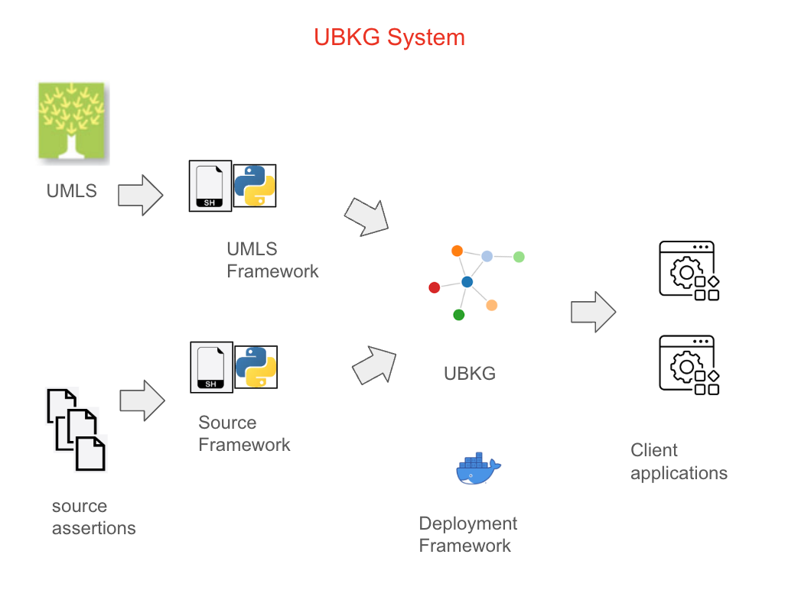

# The UBKG System

The UBKG System comprises a number of components that support a UBKG knowledge graph database.
The system's components have one of two roles:
1. Building and distributing an instance of a UBKG database
2. Clients of the UBKG database

A _framework_ in the UBKG system is a set of Bash scripts, Python scripts, and files used to execute the function of a component..

## Build and Distribution components

### Source assertion data

#### UMLS
#### non-UMLS assertions
### ETL frameworks
#### UMLS ETL
#### SAB ETL
### Distribution framework

### Client components
#### API
#### Guesdt

