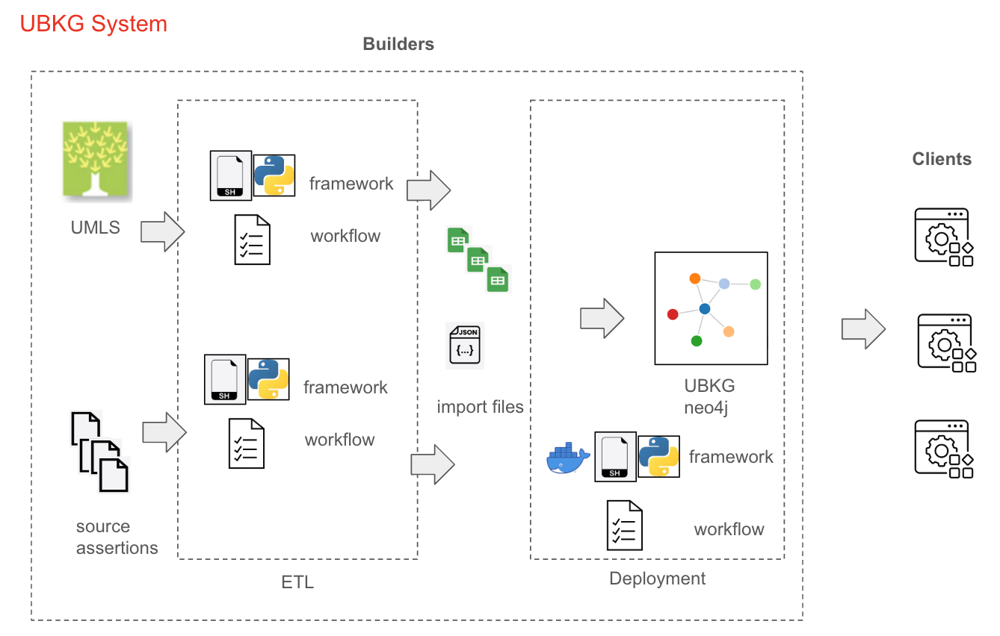

# Unified Biomedical Knowledge Graph (UBKG) 
 

# The UBKG System
---

The **UBKG System** comprises a set of components that support the construction, deployment, and use of a UBKG knowledge graph database.

System components have one of two roles:

1. **Builders** _construct_ and _deploy_ a UBKG database
2. **Clients** _use_ a UBKG database

Most of the components of the UBKG system are builders.

# System Diagram

## Frameworks and workflows
* A _framework_ in a UBKG system is a set of interrelated shell scripts, Python scripts, and resource files used to execute the functions of a component. 
* A _workflow_ in a UBKG system is a set of tasks executed in a specific order that employ frameworks. 

# Builder components

## Source assertion data
The content of a UBKG database comes from sets of annotated [assertions](./glossary/#assertion) from a variety of [sources](./glossary/#source).

Types of sources are:
* the [UMLS](./glossary/#umls)
* non-UMLS sources

## ETL workflows
Two types of [ETL workflows](../etl) translate assertion data from sources into files that can be imported into a UBKG instance:
* the translation of UMLS data
* the translation of non-UMLS source data

## Import files

The product of the translation workflows is a set of one or more _import files_ that can be imported into a neo4j instance to 
create a UBKG database. 

## Deployment workflow
Once import files are complete, a deployment workflow is used to build a _UBKG distribution_--a Zip archive 
containing a set of files that can build a local Docker container hosting an instance of neo4j populated with a UBKG database.

After being generated, a UBKG distribution can be uploaded to the [UBKG Download site](https://ubkg-downloads.xconsortia.org/). 

# Client components
Once an instance of UBKG has been deployed from a UBKG distribution, client applications can 
query the UBKG.

## neo4j browser
By default, the neo4j browser (Bolt) can be used to query the UBKG database.

## APIs
Flask-based REST APIs are available, offering endpoints that return information about the UBKG.
* The **ubkg-api** works with a UBKG in UBKG-CSV format.
* The **jkg-api** works with a UBKG in UBKG-JKG format.

## Guesdt
Guesdt (Graphing UMLS Enables Search In Dynamic Trees) is a web application that includes a front-end to a UBKG API.

