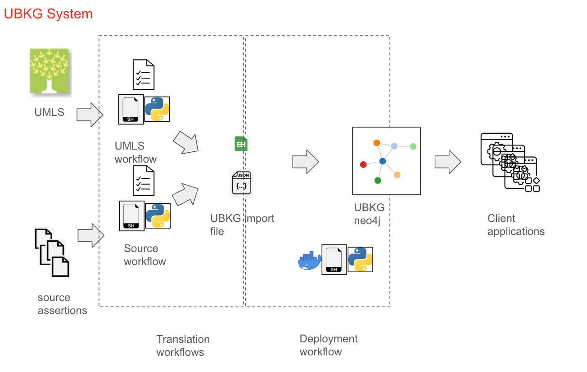

# The UBKG System

The **UBKG System** comprises a set of components that support a UBKG knowledge graph database.

System components have one of two roles:
1. To use a UBKG database--i.e., a client role
2. To building and distributing an instance of a UBKG database

Most of the components of the UBKG system are relevant primarily to users who wish to build and deploy custom instances of a UBKG.

# System Diagram

## Framework
A _framework_ in the UBKG system is a set of shell scripts, Python scripts, and files used to execute the function of a component.

## Workflow
Tasks involving frameworks to build a UBKG instance must be executed in a specific order--i.e., according to a _workflow_. 

## Build and Distribution components

### Source assertion data
The content of a UBKG database comes from sets of annotated [assertions](./glossary/#assertion) from a variety of [sources](./glossary/#source).

Types of sources are:
* the [UMLS](./glossary/#umls)
* non-UMLS sources

### Translation workflows
Two types of workflows translate assertion data from sources into files that can be imported into a UBKG instance:
* the translation of UMLS data
* the translation of non-UMLS source data

#### UMLS translation 
The UMLS releases distributions of source data biannually. Distributions are available from the [UMLS website](https://www.nlm.nih.gov/research/umls/licensedcontent/umlsknowledgesources.html).

UMLS translation workflows involve:
* obtaining a UMLS release file
* using the MetamorphoSys application to build a UMLS distribution
* extracting and translating data from UMLS distribution files into UBKG import files

#### SAB translation
Sources that are not part of the UMLS are available via a variety of forms, including:
* OWL files
* REST APIs
* custom file types
* source files in UBKG Edge/Node format

SAB translation workflows involve executing scripts that are appropriate to source formats to produce
source files in UBKG Edge/Node format.

### Import files

The product of the translation workflows is a set of one or more import files that can be imported into a neo4j instance to 
create a UBKG database. 

The form of import file depends on the UBKG architecture. 
* In the [UBKG-CSV](../../ubkg-csv), UMLS distribution files are imported into an Oracle database and extracted to a set of _ontology CSV_ files.
* In the [UBKG-JKG](../,,/ubkg-jkg), scripts translate UMLS distribution content into a single JKG JSON file.

The build of import files is iterative:
1. Import files are created from UMLS distribution data.
2. Data from non-UMLS sources is appended to the import files in a particular order.

### Deployment workflow
Once an import file is complete, a deployment workflow is used to build a _UBKG distribution_--a Zip archive 
containing a set of files that can build a local Docker container hosting an instance of neo4j populated with a UBKG database.

After being generated, a UBKG distribution can be uploaded to the [UBKG Download site](https://ubkg-downloads.xconsortia.org/). 

### Client components
Once an instance of UBKG has been deployed from a UBKG distribution, client applications can 
query the UBKG.

#### neo4j browser
By default, the neo4j browser (Bolt) can be used to query the UBKG database.

#### APIs
Flask-based REST APIs are available, offering endpoints that return information about the UBKG.
* The **ubkg-api** works with a UBKG in UBKG-CSV format.
* The **jkg-api** works with a UBKG in UBKG-JKG format.

#### Guesdt
Guesdt (Graphing UMLS Enables Search In Dynamic Trees) is a web application that includes a front-end to a UBKG API.

