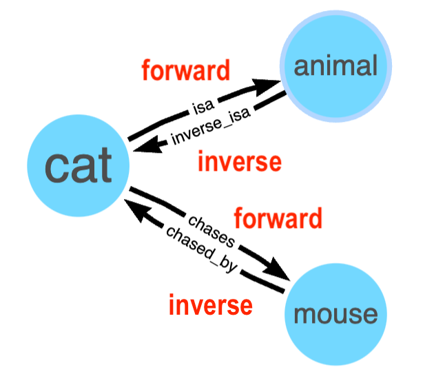

# Unified Biomedical Knowledge Graph (UBKG) 

# UBKG-CSV Assertion Model

---

In the UBKG [operational model](/about/models/#operational-model), the [assertions](/about/glossary/#assertion) that a [source](/about/glossary/#source) defines between [codes](/about/glossary/#code) 
are represented in the UBKG as [relationships](/about/glossary/#relationship) between the [concepts](/about/glossary/#concept) 
with which codes associate via [code links](/about/glossary/#code-link).

The UBKG represents each assertion that a data source makes 
involving a code with a relationship that involves the Concept node 
of the code’s associated concept subgraph. 
The original code from the data source can be resolved from the 
code’s concept subgraph.

## Inverse assertions and the Relations Ontology (RO)
The UBKG represents each assertion from a data source as a pair of 
bi-directional relationships between two concepts:
+ The _forward relationship_ represents the predicate of the original assertion, between the subject and object.
+ The _inverse relationship_ represents the predicate from the object of the original assertion to the subject.

The UBKG derives inverse assertions when importing from data sources; 
in fact, the edge file from a data source should only contain forward assertions. 

When deriving inverse assertions, the UBKG refers to the [Relations Ontology](https://www.ebi.ac.uk/ols4/ontologies/ro), 
which defines a large number of bidirectional pairs of assertion predicates. 

+ If the term for an assertion matches a relationship in RO, the UBKG will use the relationship’s corresponding inverse to derive the inverse assertion. For example, the inverse relationship for **[has_part](https://www.ebi.ac.uk/ols4/ontologies/ro/properties/http%253A%252F%252Fpurl.obolibrary.org%252Fobo%252FBFO_0000051)** in RO is **part_of**.
+ If the predicate of an assertion cannot be found in RO, the UBKG generates the default inverse assertion by prepending **inverse_** to the forward assertion.

In a previous example, the concept of _cat_ was the subject of two assertions–**_isa_** and **_chases_**. 
The UBKG might represent the bidirectional sets of assertions as follows:

